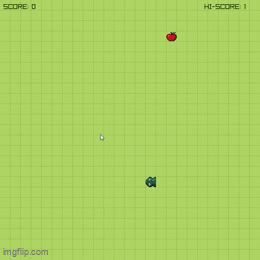
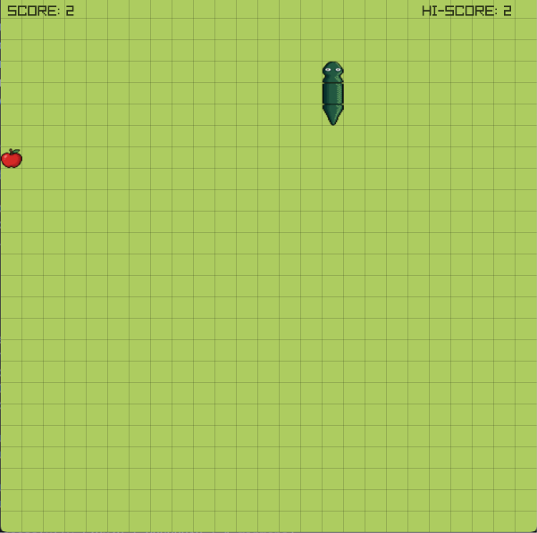
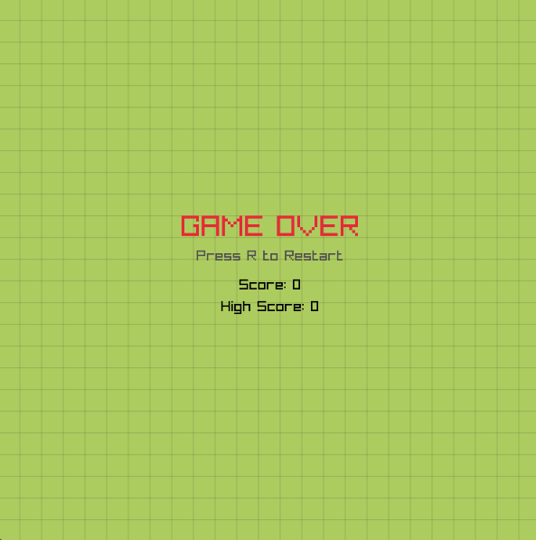

# Snake Game

<div align="center">

  <h3>Classic Snake Game using C++ and Raylib</h3>

  <p>
    A classic Snake game developed in C++ using Raylib. Instead of relying on traditional array-based body management, the game uses a custom Doubly Linked List to represent the snake dynamically in memory, enabling efficient movement and growth through constant-time node insertion and deletion.
  </p>

  <p>
    
    
    
    
  </p>

</div>

---

## Overview

**Snake Game** is a classic 2D arcade game developed using C++ and Raylib.

The player controls a snake that moves around a grid-based environment, collecting apples to increase its length and score. The game ends when the snake collides with the boundaries or its own body.

Unlike implementations that store the snake using a fixed-size array, this project uses a **Doubly Linked List** to manage individual snake segments and their movement.

## Gameplay Preview

<div align="center">

  

  <p><i>Gameplay demonstration</i></p>

</div>

## Screenshots

<div align="center">

  <table>
    <tr>
      <td align="center">
        
        <br>
        <b>Gameplay</b>
      </td>
      <td align="center">
        
        <br>
        <b>Game Over</b>
      </td>
    </tr>
  </table>

</div>

## Features

- **Snake Movement:** Control the snake using keyboard input.
- **Doubly Linked List:** Manage snake segments dynamically using nodes connected through `next` and `prev` pointers.
- **Dynamic Growth:** Increase the snake's length whenever it collects an apple.
- **Random Food Spawning:** Apples respawn at random grid positions after being collected.
- **Collision Detection:** Detect collisions with screen boundaries and the snake's own body.
- **Score System:** Track the current score and highest score during gameplay.
- **Sound Effects:** Play audio feedback when collecting apples and when the game ends.
- **Restart System:** Restart the game without closing the application.

## Controls

| Input | Action |
|---|---|
| `W` / `↑` | Move Up |
| `A` / `←` | Move Left |
| `S` / `↓` | Move Down |
| `D` / `→` | Move Right |
| `R` | Restart after Game Over |

## Technical Implementation

### 1. Doubly Linked List

The snake is represented using a Doubly Linked List, where each segment is stored as an individual node.

Each node contains:

```cpp
struct Gerbong {
    int x, y;
    Gerbong* next;
    Gerbong* prev;
};
```

The structure maintains two main pointers:

- `head` — Points to the first segment of the snake.
- `tail` — Points to the last segment of the snake.

When the snake moves, a new node is created at the head position, while the previous tail node is removed.

When an apple is collected, the tail is not removed, allowing the snake to grow naturally.

### 2. Movement System

The snake moves according to its current direction using a 2D vector.

Keyboard inputs update the direction, and a new head node is created at the next grid position.

The linked-list structure allows the body segments to follow the head without manually shifting every segment in an array.

### 3. Collision Detection

The game implements two main collision checks:

| Collision | Description |
|---|---|
| Wall Collision | Detects when the snake moves outside the grid boundaries. |
| Self Collision | Detects when the snake's head overlaps with its own body. |

Either collision triggers the Game Over condition.

### 4. Score System

The score increases whenever the snake collects an apple.

The game also tracks a high score, updating it whenever the current score exceeds the previous record.

### 5. Texture Rendering

The snake uses separate textures for its head, body, and tail.

The rendering system calculates segment directions using the relative positions of linked-list nodes, allowing the textures to rotate according to the snake's movement.

## Technical Details

| Component | Implementation |
|---|---|
| Programming Language | C++ |
| Graphics Library | Raylib |
| Data Structure | Doubly Linked List |
| Grid Size | 25 × 25 |
| Cell Size | 30 × 30 pixels |
| Window Resolution | 750 × 750 |
| Target Frame Rate | 10 FPS |
| Input | Keyboard |
| Audio | Raylib Audio |

## Requirements

- C++ Compiler
- Raylib
- Raylib audio support
- Compatible development environment

## Getting Started

1. Clone this repository:

   ```bash
   git clone https://github.com/YOUR_USERNAME/YOUR_REPOSITORY.git
   ```

2. Navigate to the project directory:

   ```bash
   cd YOUR_REPOSITORY
   ```

3. Make sure Raylib is installed and configured in your development environment.

4. Ensure all game assets are available inside the `assets/` directory.

5. Compile and run the project using your configured Raylib environment.

> **Note:** Compilation commands may vary depending on your operating system and Raylib installation.

## Project Structure

```text
Snake-Game/
├── assets/
│   ├── Apel.png
│   ├── Head.png
│   ├── Body.png
│   ├── Tail.png
│   ├── Eat.mp3
│   └── GameOver.mp3
├── screenshots/
│   ├── gameplay.gif
│   ├── gameplay.png
│   └── gameover.png
├── SnakeGame.cpp
├── .gitignore
├── LICENSE
└── README.md
```

## Future Improvements

- [ ] Prevent the snake from immediately reversing direction.
- [ ] Prevent apples from spawning inside the snake's body.
- [ ] Improve movement timing using delta time.
- [ ] Add a main menu and pause functionality.
- [ ] Save high scores between game sessions.
- [ ] Improve collision and movement handling.
- [ ] Add additional gameplay mechanics.

## License

This project is licensed under the MIT License. See the [LICENSE](LICENSE) file for details.

---

<div align="center">
  <p>Built with C++ and Raylib.</p>
</div>
